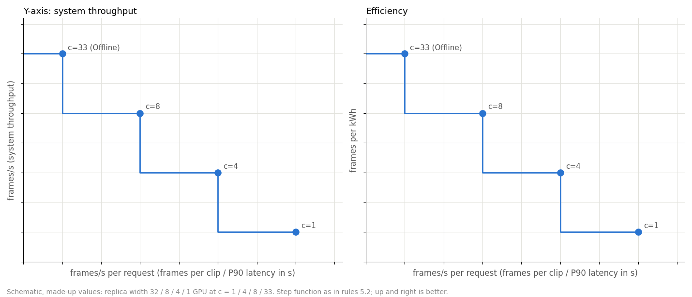

# Text-to-video (T2V) benchmark

How a text-to-video workload runs as MLPerf Endpoints points with this client:
WAN 2.2 (`wan-2.2-t2v-a14b`), 248 prompts, one video per response. The commands
for each point are in
[`examples/09_Wan22_VideoGen_Example/README.md`](../../examples/09_Wan22_VideoGen_Example/README.md).
The open items for the WG are in [Open items](#open-items).

> **Rules basis.** MLPerf Endpoints v1.0 rules on `endpoints_policies` `main` @
> `4ba8224` (2026-10-16):
> [`endpoints_rules.md`](https://github.com/mlcommons/endpoints_policies/blob/4ba8224/endpoints_rules.md)
> and
> [`endpoints_submission_rules.md`](https://github.com/mlcommons/endpoints_policies/blob/4ba8224/endpoints_submission_rules.md).
> §4.5 is marked tentative and §6.2, §6.4 and §6.5 are marked example values.

## Benchmark

- **Model and dataset.** `wan-2.2-t2v-a14b`, the MLPerf Inference
  `text_to_video` reference: 248 prompts, 81 frames per clip at 720p.
- **Sample counts.** A performance run generates at least 50 clips; the accuracy
  run covers all 248 prompts once.
- **Fixed initial latent.** The reference generates every clip from one fixed
  latent (`fixed_latent.pt`). It is a server input, loaded once at startup like
  the weights; the client refuses a dataset with a `latent_path` column. Each
  point declares the loaded latent's sha256 as `fixed_latent_sha256` in
  `point.yaml`, and the checker compares it with the catalog.
- **Reference settings.** A run bound to a `submission_ref` refuses prompt rows
  that override the reference generation settings (frames, steps, size, CFG,
  seed).
- **Accuracy.** VBench, on the reference's 0-100 scale. The gate is 0.99 x the
  BF16 reference (70.48), set once in the cohort catalog
  (`accuracy_datasets.wan22_vbench.targets`).
- **Request.** The client sends trtllm-serve's `VideoGenerationRequest` as is
  (`videogen/types.py`). With `response_format: path` the server saves the video
  and returns its path; latency is request to response.

## Point set

Proposed: **4 + 1**, one point in each of the 4 standard §5.4 regions, each with
an accuracy run, plus Offline. Today's rules ask for 8 points, or 7 when the
`C_max` point is elected as Offline (§5.3).

The regions come from `C_min` and `C_max` (§5.4, §5.5):

- **`C_min`** is the lowest submitted concurrency, between 1 and 32, unless
  `system_desc.json` sets `c_min_override`. Ultra Low is 1 to `C_min`.
- **`C_max`** is declared by the submitter and must be above 32. The High region
  ends at `C_max`, and §5.7.2 checks Offline against the point at `C_max`, so
  the top point sits at `C_max`.
- Low, Medium and High split `C_min` to `C_max` into three equal parts in log
  space. Any concurrency inside a region is allowed (§5.3).

Two choices on 32 GPUs, with `C_min = 1`. Each pick matches a replica count:

| Point                   | `C_max = 33`      | `C_max = 64`      | Replicas on 32 GPUs |
| ----------------------- | ----------------- | ----------------- | ------------------- |
| Ultra Low               | 1                 | 1                 | 1 x 32 GPU          |
| Low                     | 4 (region 2-4)    | 4 (region 2-5)    | 4 x 8 GPU           |
| Medium                  | 8 (region 5-11)   | 8 (region 6-17)   | 8 x 4 GPU           |
| High = `C_max`, Offline | 33 (region 12-33) | 64 (region 18-64) | 32 x 1 GPU          |

- **33** is the smallest legal `C_max`; one server always holds 2 requests.
  **64** puts 2 requests on every server. Both need 1200 s (§6.2).
- **Offline** is the elected `C_max` point (§5.7.2 Option 2), declared in its
  `point.yaml`, or a dedicated run (Option 1) with concurrency at least `C_max`
  and throughput at least 0.98 x the `C_max` point.
- **Accuracy** is one pass over the 248 prompts at each region point; an elected
  Offline shares the `C_max` point's run.
- **Replica width may differ per point** (§4.5.3). The curve shows a trade-off
  only when it does (see [Metrics](#metrics)).

## Metrics

Proposed, pending rule text. The unit of output is a **frame** of generated
video, so the metrics do not depend on clip length.

| Metric                     | Definition                                                     |
| -------------------------- | -------------------------------------------------------------- |
| Y-axis (system throughput) | frames/s: generated clips x frames per clip / elapsed time     |
| X-axis (per request)       | frames/s per request: frames per clip / P90 latency in seconds |
| Efficiency                 | frames per kWh: frames/s x 3600 / provisioned kW               |
| Latency                    | P90 latency, request to response                               |

- **Y-axis.** Only generated clips count: a failed clip adds no frames. The
  checker computes it from the run's `qps`, its sample counts and the catalog's
  `frames_per_sample`, and reports it as `system_fps` (not `system_tps`).
- **X-axis.** Higher is better. A value equal to the video's fps (16 for WAN
  2.2) means real time.
- **Efficiency.** Provisioned power, per point. Frames per kWh keeps the value
  well above §4.5's one decimal.
- **Across benchmarks.** Fair within one benchmark. Across benchmarks only at
  the same resolution.
- **What makes the curve meaningful.** If a replica serves one request at a
  time, per-request speed stays the same until every replica is busy, and above
  that only queueing grows. The curve shows a trade-off only when the replica
  width changes per point (wide for speed, narrow for throughput). `point.yaml`
  should record the replica size and count.

  

  Schematic with made-up values: the replica width changes per point (32, 8, 4,
  then 1 GPU at concurrency 1, 4, 8 and 33 on a 32-GPU system). As in rules §5.2
  the curve is a step function.

## Submission checker

The `2026-10-C1` cohort checks a video run (a catalog model with
`frames_per_sample`) as follows. The cohort is not a T2V cohort: the entry and
rows ride the existing one until the WG rules.

| Check                            | What it does                                                                    |
| -------------------------------- | ------------------------------------------------------------------------------- |
| `system_fps`                     | frames/s of the generated clips, always computed by the checker                 |
| token rows                       | skipped (`derived.token_output` is false); `point_latency_p90_positive` instead |
| `point_video_no_failed_samples`  | a video point has no failed samples                                             |
| `point_video_no_token_tps`       | a video point reports no token `tps`                                            |
| `point_sample_count_floor_wan22` | at least 50 generated clips in the performance run                              |
| `point_accuracy_gate`            | each catalog-gated set scores at least its gate (VBench >= 0.99 x 70.48)        |
| `point_fixed_latent_declared`    | `fixed_latent_sha256` matches the catalog                                       |
| `pareto_single_model`            | every point of a pareto declares the same model                                 |

## Open items

### Rule changes for the WG

- **Streaming (§6.5, §9.1).** Fixed-concurrency runs must stream, and a video
  response cannot, so §9.1 flags every T2V point. Proposed for §6.5: "Applies to
  benchmarks with token-streamed text output. Benchmarks whose responses are not
  token streams (for example text-to-video) are exempt, and TTFT and TPOT are
  not reported for them."
- **Sample order (§6.5).** §6.5 asks for performance prompts drawn with
  replacement. For T2V, whole passes without replacement cover every prompt
  equally and are enough. Proposed: allow `without_replacement` for T2V
  performance runs.
- **Point and accuracy count (§5.3, §9.1).** The 4 region points plus Offline as
  the minimum, with `N` = 4 accuracy runs, plus one for a dedicated Offline run.
- **`C_max` (§5.4, §5.7.2).** One request can fill a GPU, so above one request
  per replica the throughput stays flat and only queueing grows. Proposed: a
  lower `C_max` floor for T2V, and Offline defined against the highest point,
  not a point at exactly `C_max`. Then 1, 4, 8, 32 on 32 GPUs is a valid set,
  with one request per server at the top point and a 600 s minimum.
- **Fixed latent.** The rules should say the server MUST load the reference
  fixed latent (sha256 in the catalog) and log the checksum it loaded.
- **Steady state (§4.4).** The §4.4 window needs token streams, which video
  responses do not have, so T2V reports the whole-run result (the §4.4
  fallback). The whole run includes the ramp-up and drain rounds, which lower
  the reported throughput, most at high concurrency. A round-trimmed window
  would leave them out.
- **Metric consistency (§9.1).** It requires a TPOT distribution, which a video
  run does not have; it needs a video form.
- **Metrics and power unit (§4.1, §4.5).** As in [Metrics](#metrics).

### Checker work after the WG decides

| Checker result                                                 | Change                                                                                           | Depends on    |
| -------------------------------------------------------------- | ------------------------------------------------------------------------------------------------ | ------------- |
| `pareto_point_count_min`: 4 points against 7                   | Per-benchmark minimum in `Pareto.point_count_min` (`validation/submission.py`)                   | WG §5.3       |
| `pareto_accuracy_run_count`: 4 against 5, with Offline elected | An elected Offline shares the `C_max` run, so require 4, plus 1 only for a dedicated Offline run | WG §4.3, §5.3 |
| A top point at 32 is refused: `C_max` must be above 32         | Anchor Offline on the highest point                                                              | WG §5.7.2     |
| Steady state needs streaming and a tokenizer                   | Trim one round of completions at each end                                                        | WG §4.4       |

### Client follow-ups

- Requests are not routed to idle endpoints (tail latency at concurrency near
  the replica count).
- `--mode perf` still issues the accuracy prompts; use the perf-only config.
- `--mode acc` forces one worker and fails with more than one endpoint.
- The default connection warmup is far larger than a video point needs.
